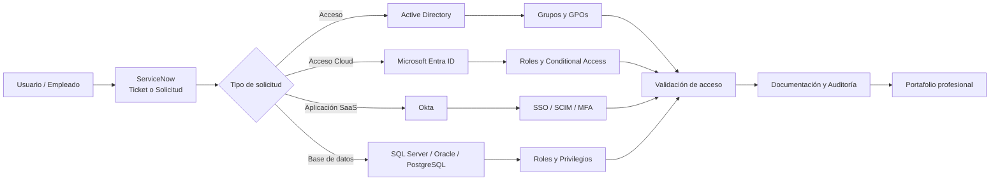
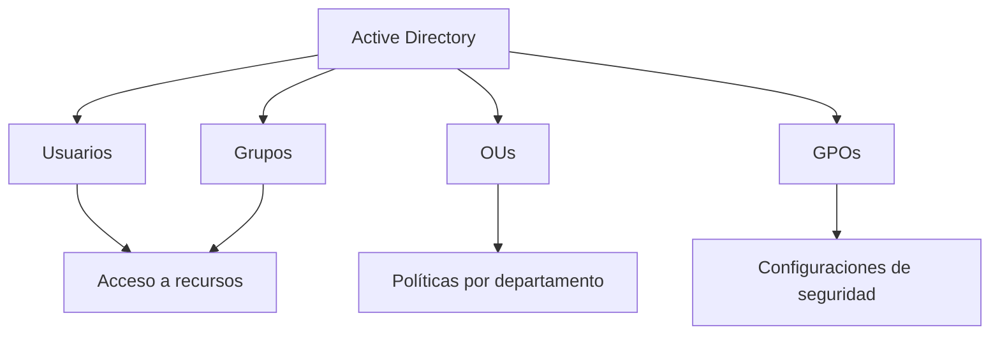
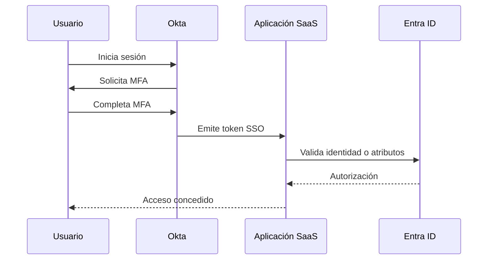
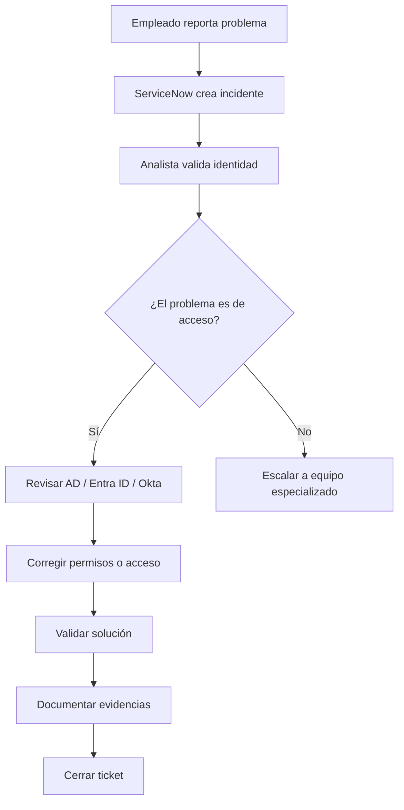

<div align="center">

# 🛡️ IT Identity, Service Desk & Database Security Lab

### Laboratorio práctico de IAM, ITSM, Identidad Híbrida, Cloud Security y Seguridad de Bases de Datos

[](https://github.com/Echo506/it-identity-servicedesk-lab)
[](https://github.com/Echo506/it-identity-servicedesk-lab/commits/main)
[](https://github.com/Echo506/it-identity-servicedesk-lab/stargazers)
[](LICENSE)
[](#)
[](#)

**Construye experiencia práctica en identidades, soporte técnico, seguridad en la nube y protección de bases de datos.**

[🚀 Comenzar](#-cómo-usar-este-laboratorio) ·
[🧭 Módulos](#-módulos-del-laboratorio) ·
[🧪 Laboratorios](#-laboratorios-prácticos) ·
[🔐 Seguridad](#-principios-de-seguridad) ·
[📊 Evidencias](#-evidencias-de-portafolio)

</div>

---

## 📌 Visión general

**IT Identity, Service Desk & Database Security Lab** es un laboratorio práctico diseñado para desarrollar habilidades alineadas con roles de **IT Support, Service Desk, IAM, SOC y Cloud Security**.

El proyecto simula un entorno empresarial moderno donde se administran identidades, accesos, tickets, políticas de seguridad, servicios en la nube y bases de datos.

Este repositorio complementa:

- [cybersecurity-learning-roadmap](https://github.com/Echo506/cybersecurity-learning-roadmap)
- [aws-iam-security-lab](https://github.com/Echo506/aws-iam-security-lab)

> 🎯 **Meta:** construir un portafolio técnico real, con evidencias verificables, documentación profesional y experiencia práctica en herramientas utilizadas por la industria.

---

## 🧠 Áreas de especialización

| Área | Tecnologías | Módulo relacionado |
|---|---|---|
| 🎫 ITSM | ServiceNow, Jira Service Management | [Módulo 01](modules/01-servicenow-fundamentals/) |
| 🧑‍💼 Identidad on-premise | Active Directory | [Módulo 02](modules/02-active-directory/) |
| ☁️ Identidad en la nube | Microsoft Entra ID | [Módulo 03](modules/03-azure-entra-id/) |
| 🔁 Identidad híbrida | Microsoft Entra Connect | [Módulo 03](modules/03-azure-entra-id/) |
| 🔑 IDaaS | Okta | [Módulo 04](modules/04-okta-sso-scim/) |
| 🔗 Integración | ServiceNow, AD, Entra ID, Okta | [Módulo 05](modules/05-incident-identity-integration/) |
| 🗄️ Bases de datos | SQL Server, Oracle, PostgreSQL | [Módulo 06](modules/06-database-identity-access-security/) |
| ⚙️ Automatización | PowerShell | [Recursos](docs/) |
| 🛡️ Seguridad | IAM, RBAC, MFA, Least Privilege | [Seguridad](#-principios-de-seguridad) |

---

## 🧭 Arquitectura del laboratorio



---

## 🚀 Cómo usar este laboratorio

1. Crea una cuenta de prueba en [ServiceNow Developer Program](https://developer.servicenow.com/).
2. Crea un tenant de prueba con el [Microsoft 365 Developer Program](https://developer.microsoft.com/microsoft-365/dev-program).
3. Crea una cuenta gratuita en [Okta Developer Edition](https://developer.okta.com/).
4. Despliega una máquina virtual de Windows Server en Azure, VirtualBox, Hyper-V o VMware.
5. Sigue los módulos en orden.
6. Completa cada laboratorio y guarda capturas, scripts y evidencias.
7. Documenta los hallazgos, permisos y decisiones de seguridad.
8. Publica tu progreso en GitHub como portafolio profesional.

> ⚠️ **Importante:** utiliza únicamente entornos de prueba. Nunca uses cuentas de producción, datos reales ni sistemas de terceros.

---

## 🧭 Módulos del laboratorio

| Módulo | Tema | Carpeta | Nivel | Tiempo estimado | Estado |
|---|---|---|---|---:|---|
| 01 | Fundamentos de ITSM y ServiceNow | [Abrir módulo](modules/01-servicenow-fundamentals/) | Básico | 2-3 horas | 🟡 En progreso |
| 02 | Active Directory: usuarios, grupos, OUs y GPOs | [Abrir módulo](modules/02-active-directory/) | Intermedio | 3-4 horas | 🟡 En progreso |
| 03 | Microsoft Entra ID: identidades, roles y acceso | [Abrir módulo](modules/03-azure-entra-id/) | Intermedio | 3-4 horas | 🟡 En progreso |
| 04 | Okta: SSO, SCIM y MFA | [Abrir módulo](modules/04-okta-sso-scim/) | Intermedio | 2-3 horas | ⚪ Pendiente |
| 05 | Integración de identidad y gestión de incidentes | [Abrir módulo](modules/05-incident-identity-integration/) | Avanzado | 2-3 horas | ⚪ Pendiente |
| 06 | Identidades, roles y privilegios en bases de datos | [Abrir módulo](modules/06-database-identity-access-security/) | Intermedio-Avanzado | 8-10 horas | 🟡 En progreso |

**Tiempo total estimado:** 20-27 horas

---

## 🎫 Módulo 01 — ITSM y ServiceNow

📁 **Carpeta del módulo:** [`modules/01-servicenow-fundamentals/`](modules/01-servicenow-fundamentals/)

### Objetivos

- Comprender el ciclo de vida de un ticket.
- Diferenciar incidentes, solicitudes, problemas y cambios.
- Crear y gestionar tickets en ServiceNow.
- Utilizar la CMDB para relacionar activos, usuarios y servicios.
- Documentar la resolución de incidencias.

### Escenario práctico

Un empleado reporta que no puede acceder a una aplicación empresarial. El analista debe:

1. Crear un incidente.
2. Identificar al usuario afectado.
3. Verificar su identidad en Active Directory o Entra ID.
4. Validar permisos, MFA o acceso a la aplicación.
5. Documentar la causa raíz.
6. Cerrar el ticket con evidencias.

---

## 🧑‍💼 Módulo 02 — Active Directory

📁 **Carpeta del módulo:** [`modules/02-active-directory/`](modules/02-active-directory/)

### Objetivos

- Crear usuarios, grupos y unidades organizativas.
- Administrar membresías de grupos.
- Configurar GPOs básicas.
- Aplicar permisos NTFS y recursos compartidos.
- Documentar la estructura del dominio.

### Arquitectura



---

## ☁️ Módulo 03 — Microsoft Entra ID

📁 **Carpeta del módulo:** [`modules/03-azure-entra-id/`](modules/03-azure-entra-id/)

### Objetivos

- Administrar usuarios, grupos y roles en Entra ID.
- Crear App Registrations.
- Configurar permisos de Microsoft Graph.
- Implementar Conditional Access.
- Aplicar MFA y políticas de acceso.
- Sincronizar identidades con Active Directory.

### Recursos clave

- [Documentación de Microsoft Entra ID](https://learn.microsoft.com/en-us/entra/identity/)
- [Conditional Access](https://learn.microsoft.com/en-us/entra/identity/conditional-access/)
- [Microsoft Graph](https://learn.microsoft.com/en-us/graph/overview)

---

## 🔑 Módulo 04 — Okta

📁 **Carpeta del módulo:** [`modules/04-okta-sso-scim/`](modules/04-okta-sso-scim/)

### Objetivos

- Configurar Single Sign-On (SSO).
- Implementar aprovisionamiento con SCIM.
- Habilitar MFA.
- Administrar el ciclo de vida de usuarios.
- Integrar aplicaciones empresariales.

### Flujo de identidad



---

## 🔗 Módulo 05 — Integración de identidad e incidentes

📁 **Carpeta del módulo:** [`modules/05-incident-identity-integration/`](modules/05-incident-identity-integration/)

### Objetivo

Simular un flujo completo de soporte técnico desde la creación de un ticket hasta la resolución del incidente.

### Flujo de trabajo



---

## 🗄️ Módulo 06 — Identidades, roles y privilegios en bases de datos

📁 **Carpeta del módulo:** [`modules/06-database-identity-access-security/`](modules/06-database-identity-access-security/)

Este módulo se enfoca en la creación y administración de identidades, roles y privilegios en bases de datos relacionales, aplicando el principio de menor privilegio y el control de acceso basado en roles.

### Motores cubiertos

| Motor | Identidades | Roles | Privilegios |
|---|---|---|---|
| Microsoft SQL Server | Logins y usuarios | Roles de servidor y base de datos | GRANT, DENY, REVOKE |
| Oracle Database | Usuarios y perfiles | Roles y privilegios de sistema | GRANT, REVOKE |
| PostgreSQL | Roles y usuarios | Roles y membresías | GRANT, REVOKE |

### Objetivos

- Diferenciar autenticación, autorización, usuario, rol y privilegio.
- Crear usuarios y roles en SQL Server, Oracle y PostgreSQL.
- Asignar y revocar privilegios sobre bases de datos, esquemas y tablas.
- Aplicar el principio de menor privilegio.
- Diseñar una matriz de control de acceso.
- Auditar usuarios, roles y permisos.
- Documentar la configuración de seguridad.

### Estructura del módulo

```text
modules/06-database-identity-access-security/
│
├── 01-theory/
│   ├── 01-database-security-fundamentals.md
│   ├── 02-sql-server-identity-access.md
│   ├── 03-oracle-identity-access.md
│   ├── 04-postgresql-identity-access.md
│   └── 05-audit-and-best-practices.md
│
├── 02-labs/
│   ├── lab-6.1-sql-server/
│   ├── lab-6.2-oracle/
│   ├── lab-6.3-postgresql/
│   └── lab-6.4-access-audit/
│
├── 03-final-project/
│   ├── technova-database-model.sql
│   ├── users-and-roles.sql
│   ├── permissions.sql
│   ├── access-tests.sql
│   ├── access-control-matrix.csv
│   └── security-report.md
│
└── 04-resources/
    ├── official-documentation.md
    └── glossary.md
```

### Enlaces directos

| Sección | Enlace |
|---|---|
| Teoría | [Abrir carpeta](modules/06-database-identity-access-security/01-theory/) |
| Laboratorios | [Abrir carpeta](modules/06-database-identity-access-security/02-labs/) |
| Proyecto final | [Abrir carpeta](modules/06-database-identity-access-security/03-final-project/) |
| Recursos | [Abrir carpeta](modules/06-database-identity-access-security/04-resources/) |
| SQL Server | [Laboratorio 6.1](modules/06-database-identity-access-security/02-labs/lab-6.1-sql-server/) |
| Oracle | [Laboratorio 6.2](modules/06-database-identity-access-security/02-labs/lab-6.2-oracle/) |
| PostgreSQL | [Laboratorio 6.3](modules/06-database-identity-access-security/02-labs/lab-6.3-postgresql/) |
| Auditoría | [Laboratorio 6.4](modules/06-database-identity-access-security/02-labs/lab-6.4-access-audit/) |
| Proyecto TechNova | [Abrir proyecto](modules/06-database-identity-access-security/03-final-project/) |

### Matriz de control de acceso

| Usuario | Rol | SELECT | INSERT | UPDATE | DELETE | CREATE | DROP |
|---|---|:---:|:---:|:---:|:---:|:---:|:---:|
| `admin_db` | Administrador | ✅ | ✅ | ✅ | ✅ | ✅ | ✅ |
| `analista` | Analista | ✅ | ❌ | ❌ | ❌ | ❌ | ❌ |
| `operador` | Operador | ✅ | ✅ | ✅ | ❌ | ❌ | ❌ |
| `consulta` | Consultor | ✅ | ❌ | ❌ | ❌ | ❌ | ❌ |
| `auditor` | Auditor | ✅ | ❌ | ❌ | ❌ | ❌ | ❌ |

---

## 🧪 Laboratorios prácticos

<details>
<summary><strong>🟦 Laboratorio 6.1 — SQL Server</strong></summary>

📁 **Abrir laboratorio:** [`modules/06-database-identity-access-security/02-labs/lab-6.1-sql-server/`](modules/06-database-identity-access-security/02-labs/lab-6.1-sql-server/)

### Objetivo

Crear usuarios, roles y permisos en Microsoft SQL Server.

### Actividades

- Crear base de datos `EmpresaDB`.
- Crear tablas `clientes`, `productos` y `ventas`.
- Crear logins y usuarios.
- Crear roles personalizados.
- Asignar permisos por perfil.
- Probar accesos.
- Revocar permisos innecesarios.

</details>

<details>
<summary><strong>🟧 Laboratorio 6.2 — Oracle Database</strong></summary>

📁 **Abrir laboratorio:** [`modules/06-database-identity-access-security/02-labs/lab-6.2-oracle/`](modules/06-database-identity-access-security/02-labs/lab-6.2-oracle/)

### Objetivo

Crear usuarios, roles y privilegios en Oracle Database.

### Actividades

- Crear usuario.
- Otorgar privilegio de sesión.
- Crear rol.
- Asignar permisos de lectura.
- Probar acceso.
- Revocar permisos.

</details>

<details>
<summary><strong>🐘 Laboratorio 6.3 — PostgreSQL</strong></summary>

📁 **Abrir laboratorio:** [`modules/06-database-identity-access-security/02-labs/lab-6.3-postgresql/`](modules/06-database-identity-access-security/02-labs/lab-6.3-postgresql/)

### Objetivo

Implementar control de acceso basado en roles en PostgreSQL.

### Actividades

- Crear base de datos `inventario`.
- Crear tablas.
- Crear roles.
- Crear usuarios.
- Asignar permisos.
- Probar accesos.
- Revocar permisos innecesarios.

</details>

<details>
<summary><strong>🔍 Laboratorio 6.4 — Auditoría de privilegios</strong></summary>

📁 **Abrir laboratorio:** [`modules/06-database-identity-access-security/02-labs/lab-6.4-access-audit/`](modules/06-database-identity-access-security/02-labs/lab-6.4-access-audit/)

### Objetivo

Detectar y corregir permisos excesivos.

### Actividades

- Revisar usuarios y roles.
- Identificar permisos innecesarios.
- Revocar privilegios excesivos.
- Crear matriz de control de acceso.
- Documentar hallazgos.
- Elaborar informe de auditoría.

</details>

---

## 📊 Evidencias de portafolio

Al finalizar el laboratorio, deberás contar con evidencias profesionales como:

- ✅ Capturas de configuración de ServiceNow.
- ✅ Usuarios, grupos y GPOs en Active Directory.
- ✅ Usuarios, roles y políticas en Microsoft Entra ID.
- ✅ Configuración de SSO, SCIM y MFA en Okta.
- ✅ Tickets de incidentes y solicitudes.
- ✅ Scripts SQL de usuarios, roles y permisos.
- ✅ Matrices de control de acceso.
- ✅ Informes de auditoría.
- ✅ Diagramas de arquitectura.
- ✅ Documentación de procedimientos.

📁 **Carpeta de evidencias:** [`docs/evidence/`](docs/evidence/)

---

## 🔐 Principios de seguridad

| Principio | Aplicación |
|---|---|
| Least Privilege | Cada identidad recibe solo los permisos necesarios |
| Separation of Duties | Ningún usuario debe tener control total sobre procesos críticos |
| RBAC | Los permisos se asignan mediante roles |
| MFA | Se exige segunda forma de autenticación |
| Auditability | Los accesos y cambios deben ser documentados |
| Zero Trust | Ningún acceso se concede sin validación |
| Data Protection | La información sensible debe estar protegida y controlada |

---

## 📚 Recursos oficiales

- [Microsoft Entra ID](https://learn.microsoft.com/en-us/entra/identity/)
- [Microsoft Entra Conditional Access](https://learn.microsoft.com/en-us/entra/identity/conditional-access/)
- [Microsoft SQL Server Security](https://learn.microsoft.com/en-us/sql/relational-databases/security/security-center-for-sql-server-database-engine-and-azure-sql-database)
- [Oracle Database Security Guide](https://docs.oracle.com/en/database/oracle/oracle-database/19/dbseg/)
- [PostgreSQL Roles](https://www.postgresql.org/docs/current/user-manag.html)
- [PostgreSQL GRANT](https://www.postgresql.org/docs/current/sql-grant.html)
- [PostgreSQL REVOKE](https://www.postgresql.org/docs/current/sql-revoke.html)
- [ServiceNow Developers](https://developer.servicenow.com/)

📁 **Carpeta de recursos:** [`docs/resources/`](docs/resources/)

---

## 🛡️ Nota de seguridad

Este laboratorio es exclusivamente para fines educativos y de desarrollo profesional.

No debe utilizarse contra sistemas de producción, cuentas reales o recursos de terceros.

Nunca incluyas credenciales, API keys, tokens, contraseñas o datos personales en este repositorio.

---

<div align="center">

### 🧑‍💻 Autor

**Wilfrido Perez Romero**  
*IT Support · IAM · Cloud Security · SOC Operations*

[](https://github.com/Echo506)
[](#)

</div>
